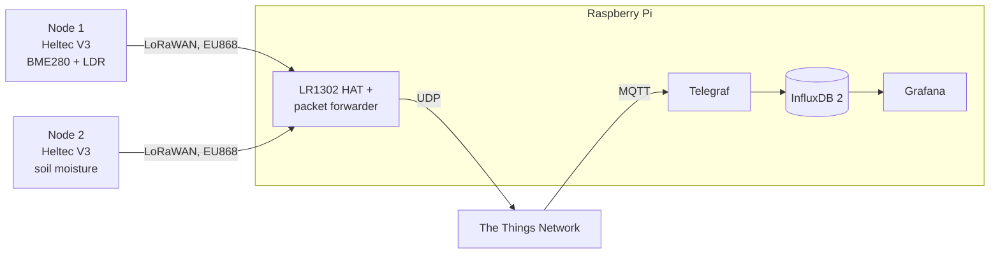

# LoRaWAN sensor network: Heltec V3 nodes to a Grafana dashboard

Two sensor nodes send temperature, humidity, pressure, light and soil-moisture readings over LoRaWAN to a self-built gateway. The readings travel through The Things Network into a time-series database and appear on live Grafana dashboards.

Built as a team course project, *Design and Development of a High-End Communication (V2X) System Using LoRaWAN Technology*, between October and December 2025. Every row marked Working below ran end to end on real hardware.



<!--
Add photos and screenshots to docs/images/, then delete this comment's
first and last lines so the pictures show here.


-->

## Status

| Part | State |
|---|---|
| Point-to-point LoRa link between two boards | Working (RSSI about -20 dBm, SNR about 11.5 dB on the bench) |
| Gateway: Raspberry Pi + LR1302, connected to TTN | Working, with a custom reset workaround |
| LoRaWAN OTAA join and uplinks, two nodes | Working |
| Downlink from TTN to a node | Working (tested from the TTN console) |
| Node 1: BME280 + LDR | Working |
| Node 2: soil moisture | Working, percentage not calibrated |
| TTN → MQTT → Telegraf → InfluxDB 2 | Working |
| Grafana dashboards for both nodes | Working |
| Gateway auto-start on boot | Not done |
| Battery operation and power measurements | Not done |
| Range test outdoors | Not done |

## Hardware

- 2 × Heltec WiFi LoRa 32 V3 (ESP32-S3, SX1262 radio, OLED), 868 MHz antennas
- Raspberry Pi with Elecrow LR1302 LoRaWAN gateway HAT (SX1302, SPI, EU868)
- GY-BME280 temperature / humidity / pressure sensor (I2C)
- LDR with a 10 kΩ resistor as a voltage divider
- Soil moisture sensor module with analog and digital outputs

## Repository layout

```
firmware/
  p2p_link_test/          Stage 1: raw LoRa sender and receiver, no gateway
  otaa_join_test/         Stage 2: LoRaWAN join with a fixed test payload
  node1_bme280_ldr/       Final firmware, node 1
  node2_soil_moisture/    Final firmware, node 2
  i2c_scanner/            Tool: lists the I2C devices that answer
gateway/                  Reset workaround and start script for the Pi
ttn/                      JavaScript payload decoder for The Things Network
pipeline/                 Telegraf configuration (MQTT in, InfluxDB out)
grafana/                  Flux queries behind every dashboard panel
docs/
  architecture.md         Data flow, payload format, design decisions, limitations
  setup-gateway.md        Setup 1: the gateway
  setup-nodes-and-ttn.md  Setup 2: the nodes and TTN
  setup-pipeline.md       Setup 3: database and dashboards
  troubleshooting.md      Every error I hit, its cause and its fix
```

## How it works

1. A node wakes up, reads its sensors and packs the values into 3 or 8 bytes ([payload format](docs/architecture.md#payload-format)).
2. It sends them as an encrypted LoRaWAN uplink. On first power-up it joins the network over the air (OTAA).
3. The gateway forwards every packet it hears to The Things Network. It cannot read them.
4. TTN checks the device, decrypts the payload and runs [`ttn/uplink_formatter.js`](ttn/uplink_formatter.js) to turn bytes into named values.
5. Telegraf on the Pi is subscribed to TTN over MQTT and writes each uplink to InfluxDB.
6. Grafana queries InfluxDB and draws the graphs.

A reading from node 1 as it appeared on the serial monitor:

```
BME280 - Temp: 25.86 C | Humidity: 33.90 % | Pressure: 948.08 hPa | Light ADC: 790
Payload (hex): 0A 1A 0D 3D 03 B4 03 16
```

## Reproducing it

Follow the three setup guides in order: [gateway](docs/setup-gateway.md), [nodes and TTN](docs/setup-nodes-and-ttn.md), [database and dashboards](docs/setup-pipeline.md).

The LoRaWAN keys are not in this repository. Each sketch folder has a `secrets.example.h`; copy it to `secrets.h` and fill in your own keys from the TTN console.

## What I learned

The full list with error messages is in [docs/troubleshooting.md](docs/troubleshooting.md). The ones that taught me the most:

- **Tools change under you.** The gateway's reset script was written for libgpiod v1. On a current Raspberry Pi OS the same `gpioset` command has different arguments and no longer exits. I replaced it with a short Python script after working out from the kernel's GPIO debug listing that stale processes were holding the pin.
- **Pick the library that matches the radio.** The popular LMIC stack compiled and printed events but never produced a packet the gateway could hear, because this board uses an SX1262. Heltec's own stack worked.
- **Byte order matters.** LMIC wants the DevEUI least-significant byte first, Heltec wants it most-significant first. Carrying the array from one sketch to the other made the node announce the wrong identity.
- **Find where the data stops before changing anything.** I spent hours on node code and TTN settings while the packet forwarder was not running. The gateway's Live data page in TTN shows in seconds whether the radio link is alive.
- **A cloud service cannot call a device on a home network.** The TTN webhook timed out because my Pi had a private IP address. MQTT works because the Pi makes the connection outwards.
- **Parsers drop what they do not understand, silently.** Telegraf's JSON parser keeps only numbers, so a `true`/`false` field showed up in TTN and never reached the database.
- **Raw LoRa and LoRaWAN are different things.** Two boards can talk raw LoRa to each other, but a LoRaWAN gateway only forwards LoRaWAN frames from registered devices.

## Limitations and next steps

See [known limitations](docs/architecture.md#known-limitations) for the details. In short:

- Slow the uplink interval from 20 s to several minutes to stay inside the TTN fair use policy.
- Move from the EU868 plan to IN865 for use in India.
- Calibrate the soil moisture sensor and move node 1's I2C pins off GPIO 1 and 3.
- Start the gateway from a systemd service on boot.
- Run the nodes from 18650 cells and measure battery life.
- Outdoor range test, logging RSSI and SNR against distance.

## Authors

- Chikkala Venkat Karthik

<!-- To do: add one line on what you did (e.g. gateway bring-up, node firmware, data pipeline), and teammates' names with their agreement. -->

## Credits

- Point-to-point sketches adapted from the `LoRa_rx_tx` example in [ropg/heltec_esp32_lora_v3](https://github.com/ropg/heltec_esp32_lora_v3) (MIT), using [RadioLib](https://github.com/jgromes/RadioLib).
- LoRaWAN sketches follow the `LoRaWan` example in [HelTecAutomation/Heltec_ESP32](https://github.com/HelTecAutomation/Heltec_ESP32).
- Gateway software: [Lora-net/sx1302_hal](https://github.com/Lora-net/sx1302_hal).
- Sensor driver: [Adafruit BME280 Library](https://github.com/adafruit/Adafruit_BME280_Library).

## Licence

[MIT](LICENSE)
