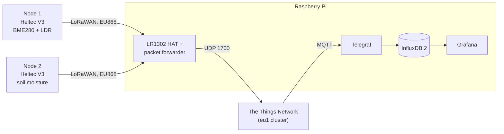

# Architecture

## Data flow

The Raspberry Pi does two separate jobs. As a gateway it forwards radio packets to TTN without understanding them. As a server it subscribes to TTN over MQTT, stores the decoded readings and draws the dashboards. The data leaves the Pi and comes back because only TTN holds the keys to decrypt it.

## What each part does

| Step | Component | Language / format | Job |
|---|---|---|---|
| 1 | Sensor node firmware | C++ (Arduino), Heltec LoRaWAN library | Read sensors, pack bytes, join the network (OTAA), send an uplink every 20 s |
| 2 | Packet forwarder (`lora_pkt_fwd` from Semtech `sx1302_hal`) | C, configured with JSON | Receive on 8 channels at once, wrap each packet in UDP and send it to TTN |
| 3 | Reset scripts | Python, Bash | Pulse the concentrator's reset pin before the forwarder starts |
| 4 | TTN network + application server | Cloud service | Check the device is registered, decrypt, remove duplicates |
| 5 | TTN payload formatter | JavaScript | Turn raw bytes into named values |
| 6 | Telegraf | TOML config | Subscribe to TTN's MQTT broker, flatten the JSON, write to InfluxDB |
| 7 | InfluxDB 2 | Flux queries | Store readings as time series |
| 8 | Grafana | Flux queries | Dashboards |

## Payload format

LoRaWAN payloads should be as short as possible, so the nodes send packed binary instead of text or JSON. Multi-byte values are big-endian (high byte first).

**Node 1 (8 bytes)**

| Bytes | Value | Type | Encoding | Example |
|---|---|---|---|---|
| 0-1 | Temperature | int16 | °C × 100 | `0A 1A` = 2586 = 25.86 °C |
| 2-3 | Humidity | uint16 | % × 100 | `0D 3D` = 3389 = 33.89 % |
| 4-5 | Pressure | uint16 | hPa | `03 B4` = 948 hPa |
| 6-7 | Light | uint16 | raw ADC, 0-4095 | `03 16` = 790 |

**Node 2 (3 bytes)**

| Bytes | Value | Type | Encoding | Example |
|---|---|---|---|---|
| 0-1 | Soil moisture | uint16 | raw ADC, 0-4095, high = dry | `09 BF` = 2495 |
| 2 | Threshold flag | uint8 | 1 = sensor DO pin high | `01` |

The decoder is [`ttn/uplink_formatter.js`](../ttn/uplink_formatter.js). It tells the nodes apart by payload length.

## Design decisions

**Heltec's LoRaWAN library instead of MCCI LMIC.** LMIC is the usual Arduino LoRaWAN stack, but it was written around the older SX127x radios and does not know this board's pin mapping. On the V3's SX1262 it compiled and printed LMIC events on serial, but the board kept resetting on the watchdog and the gateway never heard a packet. Heltec's `LoRaWan_APP.h` is written for this board and joined once the keys were right.

**MQTT instead of a webhook.** A TTN webhook is TTN's cloud calling a URL. The Pi sits on a home or college network with a private address, so TTN cannot reach it and every delivery timed out. With MQTT the Pi opens the connection outwards, which works from behind any router.

**Telegraf instead of a custom script.** It already has an MQTT input and an InfluxDB output, so the bridge is ten lines of configuration and runs as a service.

**Python for the gateway reset.** The stock reset script uses `gpioset`, whose command line changed in libgpiod v2 and which then hung on this Pi. A six-line RPi.GPIO script does the same pulse reliably. Details in [troubleshooting.md](troubleshooting.md).

**OTAA instead of ABP.** With OTAA the session keys are negotiated at each join instead of being fixed in the code, and it is the activation method TTN recommends.

## Known limitations

- **Uplink interval.** 20 s is convenient for a demo, but at SF7 an 8-byte uplink is on air for about 57 ms, which adds up to roughly 240 s per day. The TTN fair use policy allows 30 s per day per device, so a node left running should send about every 3 minutes or slower.
- **Frequency plan.** The hardware and configuration are EU868. India's licence-free band is 865-867 MHz (the IN865 plan), so a deployment in India should move the gateway, the TTN frequency plan and the node region to IN865.
- **Node 1 I2C pins.** GPIO 1 is also the board's battery-voltage sense pin and GPIO 3 is a boot strapping pin. This worked on USB power; the sensor should move to free pins before running from a battery.
- **Soil moisture is uncalibrated.** The percentage assumes 4095 = dry and 0 = wet. Real readings need the sensor's values in dry air and in water.
- **Decoder keys on payload length.** A third node with an 8-byte or 3-byte payload would be misread. Separate fPorts per node type would fix this.
- **MQTT is unencrypted** on port 1883. TTN also offers TLS on port 8883.
- **The gateway does not start on boot.** `start_gateway.sh` is run by hand after each power-up.
- **Telegraf also writes the Pi's own CPU, memory and disk metrics** into the same bucket, because the default inputs in `telegraf.conf` were left enabled.
